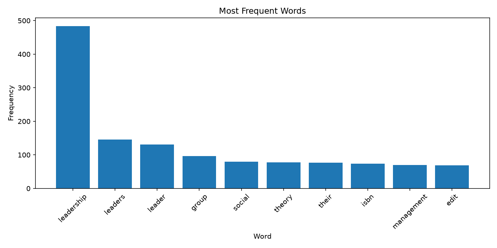
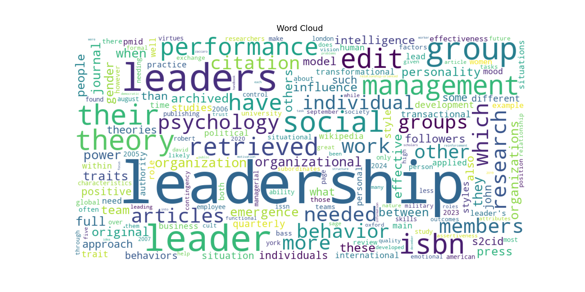

# Web Mining and Applied NLP Project Report

Web Mining and Applied NLP | Project 01 | Example Report

## Overview

This project establishes a professional Python environment
for acquiring and analyzing text from web pages.

The objective is to demonstrate that a Python project can
retrieve web content, extract text, compute word frequencies,
and produce visualizations using a reproducible workflow.

## Tools and Methods

The project uses:

- Python for text acquisition and analysis.
- Requests for retrieving HTML from web pages.
- BeautifulSoup for parsing HTML and extracting text.
- Polars for computing word frequencies.
- Matplotlib for frequency visualizations.
- WordCloud for visual exploration of vocabulary.
- Logging for execution records.
- Ruff, ty, and pytest for code verification.
- Zensical and GitHub Pages for published documentation.

The example script retrieves a Wikipedia article,
extracts text, cleans words,
and calculates token frequencies.

The analysis produces a frequency bar chart
and a word cloud.

## Verification

A successful execution displays:

    Pipeline executed successfully!

The script records execution details in a project log.

These results demonstrate that the environment can
retrieve, process, and visualize web text.

Automated tests provide additional verification
of the project's expected behavior.

## Interpretation

Web text contains both useful information and noise
introduced by document structure and formatting.

Simple text cleaning and frequency analysis
provide an initial view of a document's vocabulary.

These techniques establish a foundation
for later work involving text preprocessing,
corpus exploration, and natural language processing.

## Documentation Index

- **Home** - this landing page
- [**Project Instructions**](project-instructions.md)
- [**Glossary**](glossary.md)

## Project Links

## Project Links

- [My GitHub Repository](https://github.com/Brandon112123/nlp-01-getting-started-custom)
- [My Custom Leadership Script](https://github.com/Brandon112123/nlp-01-getting-started-custom/blob/main/src/nlp/web_words_smith.py)
- [My Original Script](https://github.com/Brandon112123/nlp-01-getting-started-custom/blob/main/src/nlp/web_words.py)
- [My Project Documentation](index.md)

## Project Resources

- [Project Instructions](project-instructions.md)
- [Professional Python Guide](https://denisecase.github.io/pro-analytics-02/)
- [Professional Python Project Explainer](https://pup-pack.github.io/professional-python-project-explainer/)

## D2: Small Technical Experiment

### Modification
I updated my Python script to filter out four common words: "from," "with," "that," and "this."

### Purpose
I wanted to see whether removing unnecessary words would make the analysis more meaningful.

### Prediction
I expected the cleaned-word count to decrease and more relevant words to appear in the results.

### Results
After running the modified script, the most frequent words included "language" (111), "natural" (69), "processing" (54), and "text" (52). The four filtered words no longer appeared in the top results.

### What I Learned
This experiment showed me how small changes in text cleaning can improve the quality of an analysis. However, words like "such" still appeared, showing that additional filtering could make the results even better.

## D3: Custom Leadership Analysis

### Research Question
What are the most frequently used words in Wikipedia's article about leadership?

### Data Source
I used the [Wikipedia Leadership article](https://en.wikipedia.org/wiki/Leadership) as my data source.

### Tools and Methods
I used Python, Requests, BeautifulSoup, Polars, Matplotlib, and WordCloud to collect, clean, analyze, and visualize the webpage. I also applied my D2 modification to remove four common words.

### Results
The program processed 21,006 raw words and 12,528 cleaned words.

The five most frequent words were:

| Word | Frequency |
|---|---:|
| leadership | 484 |
| leaders | 146 |
| leader | 131 |
| group | 96 |
| social | 80 |

### Interpretation
The results show that leadership, leaders, and leader were the most common words. The appearance of words like group and social suggests that the article frequently discusses leadership in relation to people and groups.

### What I Learned
I learned how to apply text analysis to a topic of my choice and use visualizations to identify common vocabulary.

### Limitations and Next Steps
This analysis only uses one Wikipedia article. Some website navigation text may also be included. In the future, I could improve the cleaning process and compare multiple articles about leadership.
